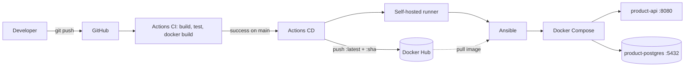
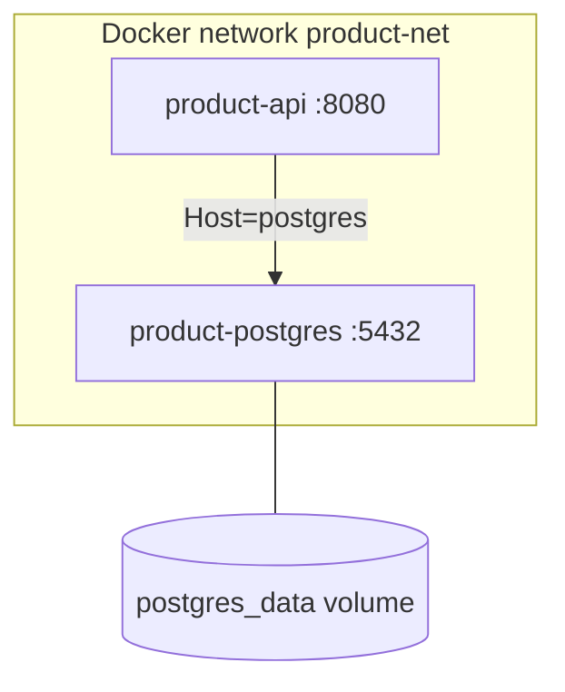
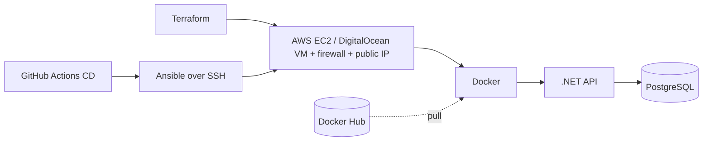

# DevOps Mini Project – Product Management API

A small, production-style **.NET 8 + PostgreSQL** API used to learn **Docker, Docker Compose, Terraform, Ansible, Docker Hub, GitHub Actions and CI/CD**, all running on a local machine. No Kubernetes, no cloud account. For a plain-language summary see [EXPLAINED.md](EXPLAINED.md); for the build checklist see [plan.md](plan.md).

## 1. Project overview
- REST API for products: `GET/POST /api/products`, `GET/PUT/DELETE /api/products/{id}`, `GET /health`, Swagger in Development.
- Layers: `Controller → Service → Repository → EF Core → PostgreSQL`.
- Everything environment-specific comes from environment variables.

## 2. Architecture





```text
Repo layout
src/ProductApi          API (Controllers, Services, Repositories, Data, Models, DTOs)
tests/ProductApi.Tests  xUnit tests
docker/Dockerfile       multi-stage image
docker-compose.yml      api + postgres (local, builds the image)
terraform/              Docker network, volume, containers (IaC)
ansible/                local deployment of the Docker Hub image
.github/workflows/      ci.yml, cd.yml
scripts/docker-push.sh  manual Docker Hub push
```

## 3. Prerequisites
.NET 8 SDK (a newer SDK also works), Docker Desktop, Terraform ≥ 1.5, Ansible (Linux/WSL2/macOS; on Windows use the bundled runner image, see §8), Git, a GitHub account and a Docker Hub account.

## 4. .NET setup
```bash
dotnet restore && dotnet build
dotnet test
# run against a local PostgreSQL (appsettings.Development.json points to localhost:5432)
dotnet run --project src/ProductApi      # http://localhost:8080/swagger
```
Migrations are applied automatically at startup (`Database.Migrate()`, with retries). Add one with
`dotnet ef migrations add <Name> -p src/ProductApi -o Data/Migrations`.

## 5. PostgreSQL setup
Defaults: DB `devops_demo`, user/password `postgres`/`postgres`, port 5432. The API reads `ConnectionStrings__DefaultConnection`. **Inside Docker use `Host=postgres`, not `localhost`.** Data lives in a named volume.

## 6. Docker setup
```bash
cp .env.example .env            # edit ports/credentials if needed
docker compose up -d --build    # run
docker compose ps               # both should be (healthy)
docker compose down             # stop (add -v to delete the DB volume)
```
Dockerfile: SDK image builds/publishes, ASP.NET runtime image runs (non-root, port 8080, `HEALTHCHECK` on `/health`). Compose: postgres `pg_isready` healthcheck, API `depends_on: service_healthy`, volume + network.

## 7. Terraform setup
```bash
cd terraform
terraform init
terraform validate
terraform plan
terraform apply          # network, volume, postgres + api containers (prefixed tf-)
terraform destroy
```
Override with `-var api_port=8085 -var postgres_port=5434 -var api_image=<user>/product-api:<tag>` or a git-ignored `terraform.tfvars` (see `terraform.tfvars.example`). `docker_host` defaults to the Windows pipe; on Linux/macOS use `unix:///var/run/docker.sock`. Use either Compose **or** Terraform on the same ports, not both at once.

## 8. Ansible setup
```bash
cd ansible
ansible-playbook -i inventory.ini playbook.yml
IMAGE_TAG=8f23a91 DOCKERHUB_USERNAME=me ansible-playbook -i inventory.ini playbook.yml   # deploy / roll back a tag
```
Requires `ansible-galaxy collection install community.docker`. The playbook checks Docker, creates the deploy dir, renders `docker-compose.yml`, pulls the image, starts/updates containers, and waits for both health checks plus `/health`. Re-running it changes nothing (idempotent).

**Windows:** build and use the helper image (Ansible + Docker CLI):
```bash
docker build -f ansible/Dockerfile.runner -t ansible-runner ansible
docker run --rm -v /var/run/docker.sock:/var/run/docker.sock -v "$PWD/ansible:/work" -v "$PWD/deploy:/deploy" \
  -e DEPLOY_DIR=/deploy -e DOCKERHUB_USERNAME=me -e health_host=host.docker.internal \
  ansible-runner -i inventory.ini playbook.yml -e health_host=host.docker.internal
```
(Add `-e pull_image=false` if the image exists only locally.)

## 9. Docker Hub setup
1. Create repository `product-api` at hub.docker.com.
2. Account Settings → Security → create an **access token**.
3. `docker login -u <user>` (paste the token), then `DOCKERHUB_USERNAME=<user> ./scripts/docker-push.sh 1.0.0` pushes `:1.0.0`, `:<git-sha>`, `:latest`.
Image name: `<dockerhub-username>/product-api:<tag>`.

## 10. GitHub setup
```bash
git init -b main && git add . && git commit -m "Initial commit"
gh repo create devops-mini-project --private --source . --push   # or create on github.com and git remote add origin ...
```
Repo → Settings → Secrets and variables → Actions → add `DOCKERHUB_USERNAME` and `DOCKERHUB_TOKEN`. Never commit `.env`, tokens or keys (see `.gitignore`).

## 11. GitHub Actions CI (`ci.yml`)
Triggers on push and pull requests: checkout → setup .NET 8 → restore → build → test → `docker build`. Any failing step fails the pipeline.

## 12. GitHub Actions CD (`cd.yml`)
Triggers when CI **succeeds on `main`**. Job `publish` (GitHub-hosted) logs in with the secrets and pushes `:latest` and `:<short-sha>`. Job `deploy` runs on your **self-hosted runner** and calls Ansible with `IMAGE_TAG=<short-sha>`, so each deploy is an immutable, rollback-able tag. The local machine is never exposed to the internet; the runner makes outbound connections only.

## 13. Self-hosted runner setup
The deploy job needs `linux` + Docker + Ansible, so on Windows use **WSL2 Ubuntu** with Docker Desktop's WSL integration enabled.
1. In WSL: `sudo apt install -y ansible python3-docker` and `ansible-galaxy collection install community.docker`.
2. GitHub repo → Settings → Actions → Runners → **New self-hosted runner** → Linux x64; run the shown `download`, `./config.sh --url ... --token ...` commands in WSL (the token is shown once, do not commit it).
3. `./run.sh` (or `sudo ./svc.sh install && sudo ./svc.sh start`).
4. Confirm the runner is "Idle" in GitHub and that `docker ps` and `ansible --version` work in that shell.

## 14. Environment variables
| Variable | Used by | Default |
|---|---|---|
| `API_PORT` | compose, ansible, terraform | 8080 |
| `POSTGRES_HOST` | .NET/local concept (compose uses service name `postgres`) | postgres |
| `POSTGRES_PORT` | compose, ansible, terraform | 5432 |
| `POSTGRES_DB` / `POSTGRES_USER` / `POSTGRES_PASSWORD` | compose, ansible, terraform | devops_demo / postgres / postgres |
| `IMAGE_TAG` | compose, ansible | latest |
| `DOCKERHUB_USERNAME` | compose, ansible, scripts | local |
| `ConnectionStrings__DefaultConnection` | API | set by compose/ansible/terraform |

Environments: **Development** (`appsettings.Development.json`, `dotnet run`), **CI** (GitHub runner, no DB needed, tests use in-memory EF), **Local deployment** (Ansible + Compose, Docker Hub image), **Future production** (same, over SSH, with real secrets via ansible-vault/env).

## 15. Running locally – quick start
```bash
cp .env.example .env && docker compose up -d --build
curl http://localhost:8080/health
curl -X POST http://localhost:8080/api/products -H "Content-Type: application/json" \
  -d '{"name":"Laptop","price":999.5,"stockQuantity":5}'
```
Swagger is available only when `ASPNETCORE_ENVIRONMENT=Development` (`dotnet run`).

## 16. Troubleshooting
| Symptom | Fix |
|---|---|
| `port is already allocated` | Another container/service uses the port. Set `API_PORT` / `POSTGRES_PORT` in `.env` (or `-var` for Terraform). |
| API restarts / cannot connect to DB | Connection string must use `Host=postgres` inside Docker. Check `docker logs product-api`. |
| `failed to connect to the docker API` | Start Docker Desktop. |
| Terraform: cannot connect to Docker | Set `docker_host` (`unix:///var/run/docker.sock` on Linux/macOS). |
| Ansible: pull fails for `local/...` | Image only exists locally: `-e pull_image=false`. |
| `terraform`/`ansible` not found on Windows | Reopen the terminal after install; use the Ansible runner image or WSL2. |
| CD `deploy` job stays queued | Runner offline or missing `linux` label; start `./run.sh`. |
| Reset the database | `docker compose down -v` |

## 17. Future remote deployment (not implemented)

Changes needed: add Terraform for the VM/firewall, change `inventory.ini` from `ansible_connection=local` to the VM's `ansible_host`/`ansible_user`/SSH key, add a task that installs Docker, store the SSH key and DB password in GitHub Secrets/ansible-vault, and let the CD `deploy` job run on a GitHub-hosted runner (no self-hosted runner needed). The application code and image stay unchanged.
